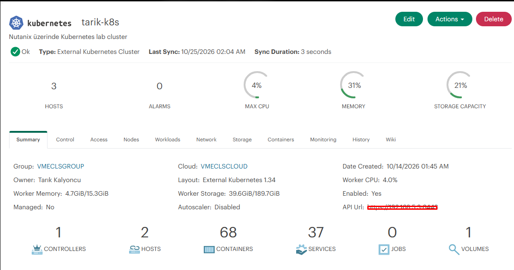
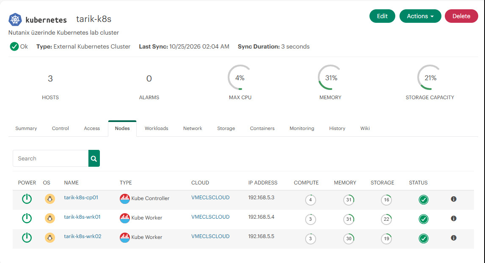
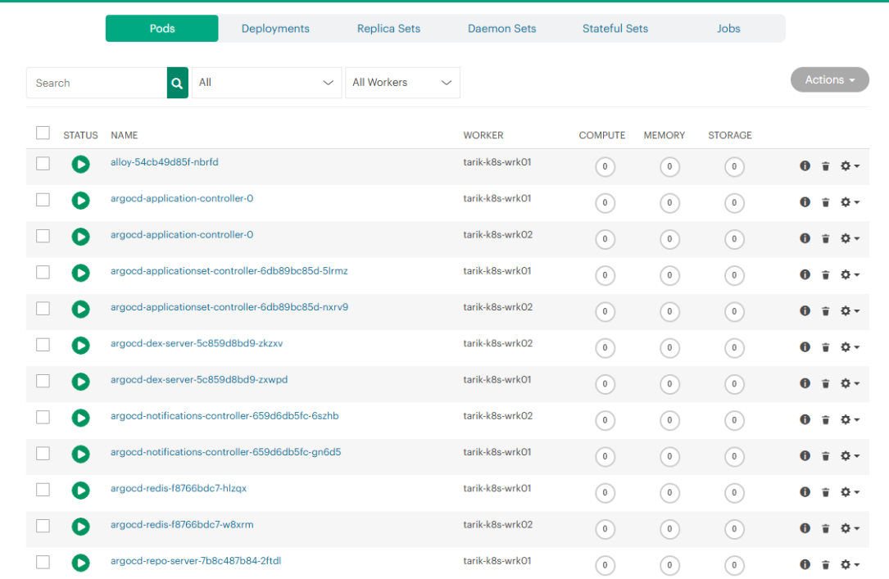

# Cloud-Native DevOps & GitOps Platform

A production-inspired cloud-native platform built on **Nutanix AHV private cloud infrastructure**, designed to demonstrate a complete DevOps workflow covering infrastructure automation, CI/CD, Kubernetes, GitOps, ingress networking, TLS management, observability, centralized logging, and hybrid cloud management.

The platform integrates **Ansible, Jenkins, Harbor, Kubernetes, Argo CD, HPE Morpheus, NGINX Ingress, MetalLB, cert-manager, Prometheus, Grafana, Alertmanager, Loki, and Grafana Alloy** into a working end-to-end environment.

Rather than demonstrating individual tools in isolation, this project focuses on how modern infrastructure and DevOps components interact as a complete platform.

---

## Platform Highlights

- Kubernetes cluster running on **Nutanix AHV**
- Infrastructure automation with **Ansible**
- Automated CI pipeline with **Jenkins**
- Private container registry with **Harbor**
- GitOps-based continuous delivery with **Argo CD**
- Kubernetes integration with **HPE Morpheus**
- Bare-metal LoadBalancer implementation with **MetalLB**
- Host-based application routing with **NGINX Ingress**
- Automated TLS certificate management with **cert-manager**
- Internal Certificate Authority for lab services
- HTTPS access through `*.kubeops.local` endpoints
- External VM service integration through Kubernetes networking
- Infrastructure and Kubernetes monitoring with **Prometheus and Grafana**
- Centralized logging with **Grafana Alloy and Loki**
- Alert management with **Prometheus Alertmanager**

---

## Architecture

```text
                         GitHub
                            |
                            v
                         Jenkins
                            |
                    Build Docker Image
                            |
                            v
                          Harbor
                    Private Registry
                            |
                  Update Git Manifest
                            |
                            v
                         GitHub
                            |
                            v
                         Argo CD
                            |
                    GitOps Reconciliation
                            |
                            v
               +-------------------------+
               |    Kubernetes Cluster   |
               |                         |
               |  Control Plane          |
               |  Worker 01              |
               |  Worker 02              |
               |                         |
               |  NGINX Ingress          |
               |  MetalLB                |
               |  cert-manager           |
               |  Morpheus Agent         |
               +------------+------------+
                            |
                     192.168.5.240
                      MetalLB VIP
                            |
               +------------+------------+
               |                         |
               v                         v
     demo.kubeops.local       grafana.kubeops.local
               |                         |
               v                         v
       Kubernetes Service       Kubernetes Service
               |                         |
               v                         v
          demo-app Pods          External Endpoint
                                         |
                                         v
                                  192.168.5.6:3000
                                         |
                                         v
                                      Grafana
```

---

## Infrastructure

The lab environment runs on **Nutanix AHV** and consists of dedicated virtual machines for CI/CD, Kubernetes, automation, monitoring, logging, and container registry services.

| Host | IP Address | Role |
|---|---|---|
| `tarik-ci01` | `192.168.5.1` | Jenkins CI/CD |
| `tarik-git01` | `192.168.5.2` | Git services |
| `tarik-k8s-cp01` | `192.168.5.3` | Kubernetes Control Plane |
| `tarik-k8s-wrk01` | `192.168.5.4` | Kubernetes Worker |
| `tarik-k8s-wrk02` | `192.168.5.5` | Kubernetes Worker |
| `tarik-monitor01` | `192.168.5.6` | Prometheus, Grafana, Alertmanager |
| `tarik-ops01` | `192.168.5.7` | Ansible / Management |
| `tarik-reg01` | `192.168.5.8` | Harbor Container Registry |
| `tarik-log01` | `192.168.5.9` | Loki Centralized Logging |

---

## CI/CD Pipeline

The application delivery workflow follows a complete automated pipeline:

```text
Developer
   |
   v
GitHub
   |
   v
Jenkins
   |
   +-- Validate automation
   +-- Build Docker image
   +-- Authenticate to Harbor
   +-- Push versioned image
   +-- Update Kubernetes manifest
            |
            v
          GitHub
            |
            v
          Argo CD
            |
            v
        Kubernetes
```

Jenkins builds the application container image and pushes both versioned and `latest` tags to Harbor.

After the image is published, Jenkins updates the Kubernetes deployment manifest in Git. Argo CD detects the Git change and automatically reconciles the desired state with the Kubernetes cluster.

This makes **Git the source of truth** for application deployment.

### Jenkins Pipeline


---

## Harbor Container Registry

A private **Harbor registry** is used to store application container images.

Example image path:

```text
harbor.kubeops.local/kubeops/demo-app:<tag>
```

The Kubernetes cluster authenticates against Harbor and pulls application images directly from the private registry.


---

## Kubernetes Cluster

The Kubernetes environment consists of:

- 1 Control Plane node
- 2 Worker nodes
- `containerd` container runtime
- Flannel CNI
- Helm package management

The cluster hosts the demo application and supporting workloads used throughout the platform.

```text
tarik-k8s-cp01
      |
      +----------------+
      |                |
      v                v
tarik-k8s-wrk01   tarik-k8s-wrk02
```

---

## GitOps with Argo CD

**Argo CD** provides continuous delivery using GitOps principles.

```text
Git Repository
      |
      v
   Argo CD
      |
      v
Kubernetes API
      |
      v
Desired State
```

The `kubeops-demo-app` application uses automated synchronization and self-healing.

GitOps coverage includes:

- Application manifests
- Ingress resources
- MetalLB configuration
- TLS certificates
- Certificate issuers
- External service definitions

---

## Kubernetes Networking & Ingress

The platform uses **NGINX Ingress Controller** to provide centralized host-based access to services.

```text
Client
  |
  v
192.168.5.240
  |
  v
MetalLB
  |
  v
NGINX Ingress
  |
  +--> demo.kubeops.local
  |         |
  |         v
  |    demo-app Service
  |         |
  |         v
  |    demo-app Pods
  |
  +--> grafana.kubeops.local
            |
            v
      grafana-external
```

The NGINX Ingress Controller is exposed through a Kubernetes `LoadBalancer` service.

---

## MetalLB Load Balancing

Because the Kubernetes cluster runs on private infrastructure rather than a public cloud provider, **MetalLB** provides LoadBalancer functionality.

Configured address pool:

```text
192.168.5.240 - 192.168.5.250
```

The NGINX Ingress Controller receives:

```text
192.168.5.240
```

MetalLB operates in **Layer 2 mode**, providing LoadBalancer functionality for the private Kubernetes environment.

---

## TLS & Certificate Management

**cert-manager** is deployed inside Kubernetes to automate certificate lifecycle management.

The lab uses an internal Certificate Authority:

```text
Self-Signed Issuer
        |
        v
     Lab Root CA
        |
        v
  CA ClusterIssuer
        |
        +----------------+
        |                |
        v                v
 demo-app TLS        Grafana TLS
```

Certificates are issued for:

```text
demo.kubeops.local
grafana.kubeops.local
```

Certificates are stored as Kubernetes TLS secrets and referenced by Ingress resources, providing HTTPS access to lab services.

---

## Demo Application Access

The demo application is exposed through NGINX Ingress using:

```text
https://demo.kubeops.local
```

Traffic flow:

```text
Client
  |
  v
192.168.5.240
  |
  v
NGINX Ingress
  |
  v
demo-app Service
  |
  v
demo-app Pods
```

TLS is managed by cert-manager using the internal lab CA.

---

## External Service Integration

The platform demonstrates how a service running **outside Kubernetes** can be exposed through Kubernetes networking.

Grafana runs directly on the monitoring VM:

```text
tarik-monitor01
192.168.5.6:3000
```

It is exposed through:

```text
https://grafana.kubeops.local
```

Traffic flow:

```text
Client
  |
  v
grafana.kubeops.local
  |
  v
192.168.5.240
  |
  v
NGINX Ingress
  |
  v
grafana-external Service
  |
  v
EndpointSlice
  |
  v
192.168.5.6:3000
  |
  v
Grafana
```

The selectorless Kubernetes Service is managed through GitOps, while the external backend is represented through an EndpointSlice.

This allows Kubernetes to provide a unified ingress layer for both containerized applications and traditional VM-based services.

---

## HPE Morpheus Integration

The Kubernetes cluster is integrated with **HPE Morpheus** as an External Kubernetes Cluster, extending the environment into a hybrid cloud management use case.

Morpheus provides centralized visibility into cluster health, infrastructure resources, Kubernetes nodes, workloads, containers, services, storage, and resource utilization.

### Cluster Overview

The Kubernetes environment can be viewed and monitored through the Morpheus cluster interface.



### Kubernetes Node Discovery

Morpheus discovers the complete three-node Kubernetes topology:

- 1 Control Plane
- 2 Worker Nodes



### Workload Visibility

Morpheus provides visibility into workloads running across the Kubernetes cluster, including Pods, Deployments, ReplicaSets, DaemonSets, StatefulSets, and Jobs.

Platform workloads such as **Argo CD** and **Grafana Alloy** can also be inspected through the Morpheus interface.



---

## Infrastructure Automation with Ansible

**Ansible** is used to automate infrastructure configuration across the environment.

Automation includes:

- Base Linux configuration
- CI server preparation
- Harbor installation
- Kubernetes installation and cluster configuration
- Monitoring stack deployment
- Node Exporter deployment
- Prometheus target configuration
- Alertmanager configuration
- Prometheus alert rules
- Loki installation
- Grafana Alloy deployment
- Persistent storage configuration

Example playbooks:

```text
base-setup.yml
ci-setup.yml
registry-setup.yml
harbor-setup.yml
kubernetes-setup.yml
kubernetes-cluster.yml
kubernetes-harbor.yml
monitoring-setup.yml
node-exporter.yml
prometheus-targets.yml
alertmanager-setup.yml
prometheus-alerts.yml
loki-setup.yml
alloy-setup.yml
gameshelf-storage.yml
```

---

## Monitoring & Observability

The monitoring stack consists of:

- **Prometheus**
- **Node Exporter**
- **kube-state-metrics**
- **Grafana**
- **Alertmanager**

```text
Linux Servers --> Node Exporter --------+
                                        |
Kubernetes --> kube-state-metrics ------+--> Prometheus --> Grafana
                                        |
                                        +--> Alertmanager
```

The dashboards provide visibility into CPU, memory, disk, network, node health, Kubernetes workloads, pod status, and cluster resources.

### Infrastructure Dashboard


### Node Monitoring


### Kubernetes Monitoring


---

## Alerting

Prometheus alert rules are used to detect infrastructure and Kubernetes failures.

Implemented alerts include:

```text
NodeDown
KubernetesPodNotRunning
```

The `NodeDown` alert was tested by intentionally stopping Node Exporter on a monitored system.


```text
Target Failure
      |
      v
  Prometheus
      |
      v
 Alert Rule
      |
      v
 Alertmanager
```

---

## Centralized Logging

Centralized logging is implemented using **Grafana Alloy and Loki**.

### Linux Log Flow

```text
Linux systemd journal
        |
        v
   Grafana Alloy
        |
        v
       Loki
        |
        v
      Grafana
```


### Kubernetes Log Flow

```text
Kubernetes Pods
      |
      v
 Grafana Alloy
      |
      v
     Loki
      |
      v
 Grafana Explore
```

Kubernetes logs include labels such as:

```text
cluster
namespace
pod
container
app
```


Loki data is persisted under:

```text
/var/lib/loki
```

---

## Repository Structure

```text
cloud-native-devops-platform/
|
+-- ansible/
|   +-- ansible.cfg
|   +-- inventory
|   +-- playbooks/
|
+-- app/
|   +-- Dockerfile
|   +-- index.html
|
+-- docs/
|   +-- images/
|
+-- kubernetes/
|   +-- deployment.yaml
|   +-- service.yaml
|   +-- demo-app-ingress.yaml
|   +-- demo-app-certificate.yaml
|   +-- metallb-pool.yaml
|   +-- selfsigned-issuer.yaml
|   +-- lab-ca.yaml
|   +-- lab-ca-issuer.yaml
|   +-- grafana-external.yaml
|   +-- grafana-certificate.yaml
|   +-- grafana-ingress.yaml
|   +-- alloy-logs.yaml
|   +-- gameshelf-postgres.yaml
|   +-- gameshelf-storage.yaml
|
+-- kubedefender/
|
+-- Jenkinsfile
+-- README.md
```

---

## Technology Stack

| Category | Technology |
|---|---|
| Private Cloud / Virtualization | Nutanix AHV |
| Operating System | Ubuntu Server |
| Infrastructure Automation | Ansible |
| Source Control | Git / GitHub |
| Continuous Integration | Jenkins |
| Containers | Docker |
| Container Registry | Harbor |
| Container Runtime | containerd |
| Container Orchestration | Kubernetes |
| GitOps / Continuous Delivery | Argo CD |
| Cloud Management | HPE Morpheus |
| Ingress | NGINX Ingress Controller |
| Load Balancing | MetalLB |
| TLS / PKI | cert-manager / Internal CA |
| Metrics | Prometheus |
| Host Metrics | Node Exporter |
| Kubernetes Metrics | kube-state-metrics |
| Visualization | Grafana |
| Alerting | Alertmanager |
| Centralized Logging | Loki |
| Log Collection | Grafana Alloy |

---

## End-to-End Delivery Flow

```text
Code Change
    |
    v
  GitHub
    |
    v
 Jenkins
    |
    +--> Build
    +--> Containerize
    +--> Push Image
            |
            v
          Harbor
            |
            v
 Update Git Manifest
            |
            v
          GitHub
            |
            v
          Argo CD
            |
            v
       Kubernetes
            |
            v
       NGINX Ingress
            |
            v
          HTTPS
```

---

## Observability Flow

```text
Infrastructure
     |
     +--> Node Exporter -----------+
     |                             |
Kubernetes --> kube-state-metrics -+--> Prometheus
     |                             |        |
     |                             |        +--> Grafana
     |                             |
     |                             +--------+--> Alertmanager
     |
     +--> Grafana Alloy --> Loki ---------> Grafana
```

HPE Morpheus provides an additional management and visibility layer over the Kubernetes cluster.

---

## What This Project Demonstrates

This project demonstrates practical experience across the complete infrastructure and application delivery lifecycle:

- Designing and operating Kubernetes on private cloud infrastructure
- Automating infrastructure configuration with Ansible
- Building CI workflows with Jenkins
- Managing private container images with Harbor
- Implementing GitOps-based continuous delivery with Argo CD
- Integrating Kubernetes with HPE Morpheus
- Implementing LoadBalancer services with MetalLB
- Configuring centralized ingress routing with NGINX
- Managing TLS certificates with cert-manager
- Building an internal PKI workflow for lab services
- Routing Kubernetes traffic to external VM-based services
- Monitoring Linux and Kubernetes infrastructure with Prometheus
- Building operational dashboards with Grafana
- Implementing infrastructure and workload alerting
- Collecting centralized Linux and Kubernetes logs with Alloy and Loki

The result is an integrated cloud-native platform where infrastructure automation, application delivery, networking, TLS, observability, and cloud management operate together as a single environment.

